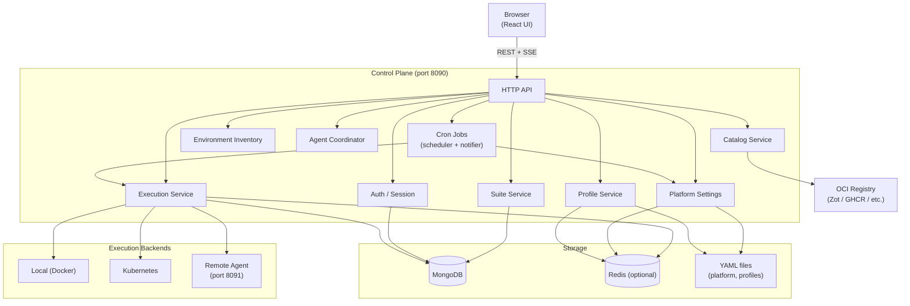
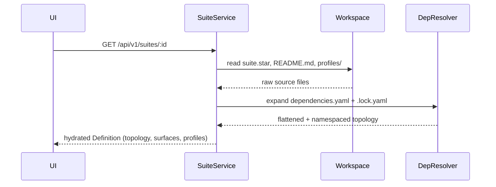
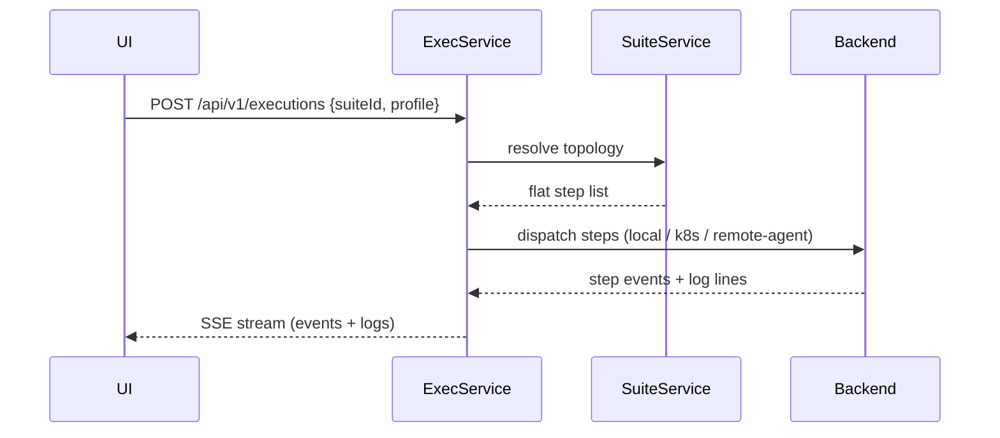
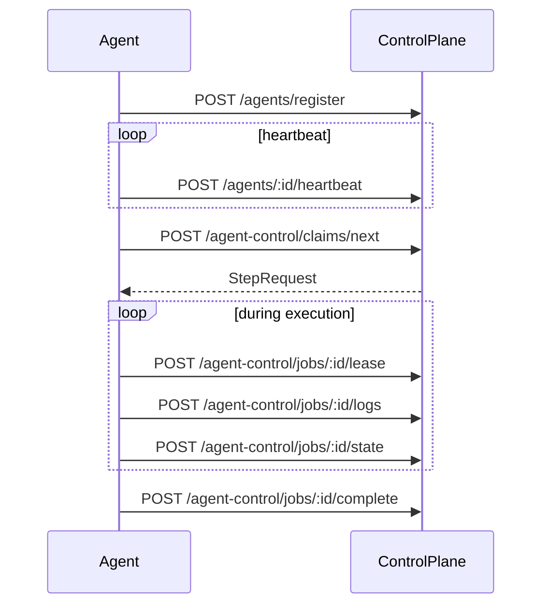
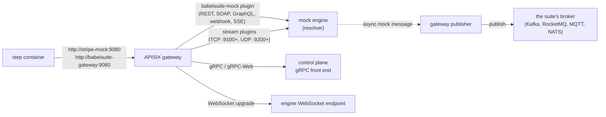

# Architecture

[Back to index](index.md)

## High-Level Shape

BabelSuite is split into four main layers:

1. **Frontend** — React UI for catalog, suites, profiles, executions, environments, and settings
2. **Control plane** — HTTP API server: auth, platform settings, profiles, catalog, suite resolution, execution orchestration
3. **Execution backends** — local Docker, Kubernetes, or remote agent
4. **Runtime infrastructure** — primary datastore, optional cache, telemetry pipeline, Docker



## Control Plane Composition

The control plane is assembled in:

- `backend/cmd/server/main.go`
- `backend/cmd/server/app.go`
- `backend/cmd/server/support.go`

The server wires together:

- authentication
- suite loading
- profile management
- catalog discovery
- execution orchestration
- environment inventory
- platform settings
- agent registry and assignment coordination
- telemetry, request middleware, and readiness probes

## Data Flows

### Suite resolution flow



### Execution launch flow



### Remote worker flow



## Mock Traffic

A suite's mocks are answered by its APISIX sidecar, the *gateway*. The control plane's mock engine decides what the answer is; the gateway is the visible responder. There is one gateway per suite and profile, shared by every run of the suite, and each run's own network is attached to it.



| Surface | Served by | Notes |
|---------|-----------|-------|
| REST, SOAP, GraphQL, webhook, SSE | `babelsuite-mock` plugin in the gateway | the plugin asks the engine which example matches and writes the response itself, so every other plugin of the route still applies |
| gRPC, gRPC-Web | the control plane's gRPC front end, behind the gateway | a gRPC success ends in an HTTP/2 trailer, which no Lua in APISIX can write. The gateway checks the call and forwards it; gRPC errors the gateway itself raises are real trailers-only gRPC errors. The suite's `.proto` files are compiled at run time and the front end offers reflection. Unary and server-streaming methods are mocked; a client-streaming method answers `UNIMPLEMENTED` |
| WebSocket | the engine's WebSocket endpoint, proxied by the gateway | an upgrade cannot be accepted by Lua. On connect the matched example is sent (a JSON array is one frame per element); each client message is put to the engine like a request body |
| TCP, UDP | stream plugins in the gateway | a raw transport carries nothing that says which operation it is for, so every operation has a port of its own (TCP from 9100, UDP from 9200). A step is told them in `BABELSUITE_TCP_MOCKS` / `BABELSUITE_UDP_MOCKS` |
| Kafka, RocketMQ, MQTT, NATS | the gateway as a *publisher* | a broker is not a server a client connects to: the example message is published to the broker the surface names (`kafka://broker:9092`, topic = the operation's name) once that service is up. See the limits below |
| AMQP, an async surface that names no broker | not served | APISIX has no AMQP client; a surface with no broker has nowhere to publish. The run says so as a warning when the mock starts |

**Reaching a mock.** A step on the run's network reaches the gateway as `babelsuite-gateway`, and every mock node by its own name (`http://stripe-mock:9080`). A surface's declared host (`<suite>.mock.internal`, `api.example.test`) answers on the gateway too.

**The token.** The engine answers a mock call only when it carries the gateway's token, so a mock cannot be driven by calling the control plane's `/mocks` endpoints directly: those answer `401`. The token is `MOCK_SHARED_SECRET` when set, otherwise it is derived from the signing secret, so it differs for every deployment and survives a restart. The sidecar gets it in its environment; nothing is written into its configuration file.

**Run scope.** A stateful mock keeps one state per run. The gateway tells the engine which run a request came from by the address it arrived on, so two runs of one suite never see each other's state.

**Limits of async publishing.**

- The gateway publishes by the broker container's address on the run's network. A Kafka or RocketMQ broker answers a client with the address it *advertises* (for the Kafka module, `<name>:9092`), which the gateway cannot resolve, so publishing to those two can fail where the advertised name is not an address. MQTT and NATS carry no such redirect.
- The broker must be a service of the suite (`service.run`); a mock that names another host is reported and not published.
- The message is published once, when the broker service becomes healthy.

## Main Backend Domains

| Package | Responsibility |
|---------|---------------|
| `internal/auth` | Local auth, session handling, OIDC login, JWT issuance |
| `internal/platform` | Agents, registries, secrets, platform settings |
| `internal/catalog` | Registry discovery and catalog package views |
| `internal/suites` | Suite loading, topology resolution, nested suite expansion |
| `internal/profiles` | Suite profile CRUD and validation |
| `internal/execution` | Launch, orchestration, runtime state, SSE streams |
| `internal/agent` | Worker registry, coordinator, worker control APIs |
| `internal/environments` | Environment inventory and cleanup APIs (served under `/api/v1/sandboxes`) |
| `internal/engine` | Rolling execution overview and its SSE stream |
| `internal/cronjobs` | Scheduled suite runs, reports, and notifications |
| `internal/mocking` | Mock surface resolution and the REST/gRPC/async handlers |
| `internal/queue` | Dependency-ordered step scheduling |
| `internal/telemetry` | OpenTelemetry tracer and meter setup |
| `internal/httpserver` | Middleware: request IDs, audit hooks, tracing context |
| `internal/store` | Datastore and cache abstractions (MongoDB, Redis) |

## Frontend Surface

The React app currently exposes:

- home dashboard
- catalog browser
- suites explorer
- profiles manager
- live execution page
- environments page
- settings pages for general, agents, registries, and secrets
- local auth and SSO callback pages

## Storage Model

### Primary store

The control plane uses MongoDB by default (`MONGO_URI`, `MONGO_DB`), or PostgreSQL with `DB_DRIVER=postgres` and `POSTGRES_URL`. Both implement the same `store.Store` and the runtime repositories (agents, assignments, executions, cron jobs), and one contract test in `internal/store/storetest` runs against both. See [Configuration](configuration.md#datastore).

### Cache layer

Redis is optional and accelerates:

- cached reads for platform settings, profiles, and catalog
- execution runtime state
- coordination fast paths

The primary store remains the authority for persisted application state.

### File-backed state

Platform settings and managed profiles are stored in YAML files on disk:

- `configuration.yaml` — agents, registries, secrets
- `babelsuite-profiles.yaml` — managed profile records

Both are optionally cached in Redis.

## Middleware Stack

The server wraps all API traffic with shared middleware in this order:

```
Recovery → Security Headers → CORS → CSRF → Body Limit (10 MB) →
Request IDs → Auth Session → OTel Trace → Trace Context → HTTP Metrics → Audit
```

This keeps system-wide concerns centralized rather than re-implemented in each handler.

For full middleware details, see [Control Plane Reference](control-plane.md).
