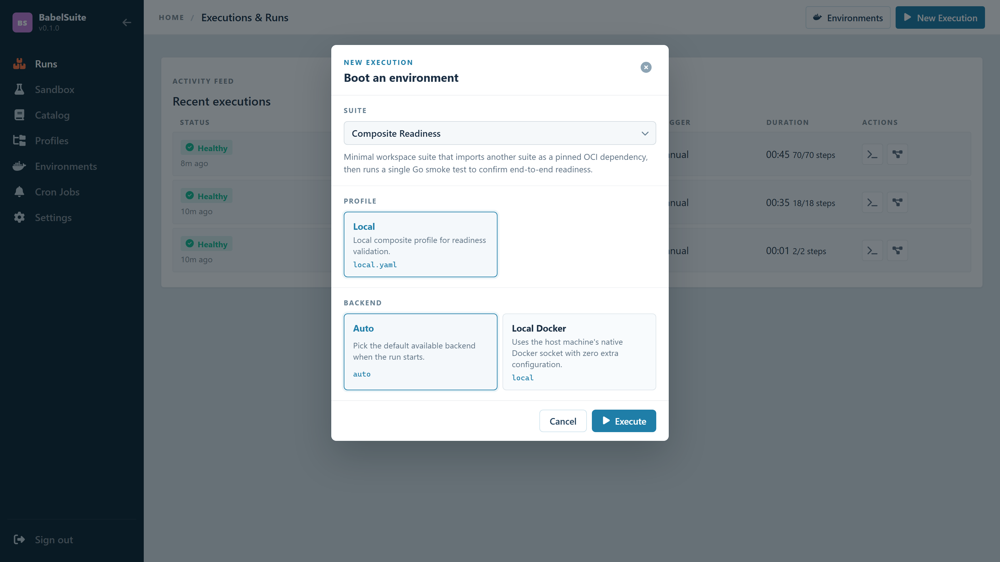
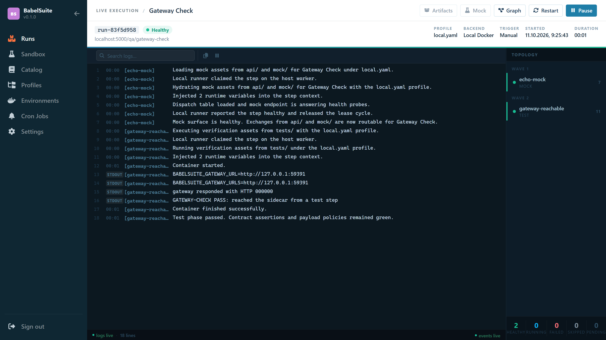

# Getting Started

[Back to index](index.md)

## What You Run

BabelSuite has three primary executables:

| Binary | Path | Purpose |
|--------|------|---------|
| `babelsuite` server | `backend/cmd/server` | Control plane API (port 8090) |
| `babelsuite` agent | `backend/cmd/agent` | Remote worker (port 8091) |
| `babelctl` | `backend/cmd/ctl` | CLI client |

The frontend lives in `frontend/` and runs as a separate Vite dev server on port 5173.

## Prerequisites

- **Go** — backend binaries
- **Node.js** — frontend dev server
- **MongoDB** or **PostgreSQL** — primary datastore (MongoDB is the default)
- **Docker** — local container execution and environment inventory
- **Redis** *(optional)* — cache layer and faster runtime coordination

The checked-in `.env` defaults to MongoDB + Redis.

!!! tip "Shortcut"
    [`demo/`](demo.md) brings the datastore, cache and registry up in one
    compose stack and loads every bundled suite, module and plugin into it.
    Use it if you want a working install rather than a tour of the pieces.

## Local Development

### 1. Configure the environment

The repo root includes a `.env` file. Common local settings:

```bash
JWT_SECRET=change-me-to-a-secure-random-value
ADMIN_EMAIL=admin@babelsuite.test
ADMIN_PASSWORD=admin

PORT=8090
FRONTEND_URL=http://localhost:5173

# Keep this relative so the browser stays same-origin through the Vite proxy.
# An absolute URL makes the API cross-origin, the csrf_token cookie is dropped,
# and sign-in fails with 403.
VITE_API_URL=/

MONGO_URI=mongodb://localhost:27017
MONGO_DB=babelsuite

PLATFORM_SETTINGS_FILE=configuration.yaml
PROFILES_FILE=babelsuite-profiles.yaml
```

See [Configuration](configuration.md) for the full variable reference.

### 2. Start the backend

From the `backend/` directory:

```bash
go run ./cmd/server
```

The server listens on `http://localhost:8090`.

### 3. Start the frontend

From the `frontend/` directory:

```bash
npm install
npm run dev
```

Vite serves the UI at `http://localhost:5173`.

### 4. Start a remote worker (optional)

If you want to test remote-agent execution:

```bash
go run ./cmd/agent
```

The worker process exposes its own health and execution API and registers with the control plane.

## Default Local Login

!!! note "Seeded admin account"
    The backend seeds an initial admin account on first startup. Use these credentials to sign in locally:

    - **Email:** `admin@babelsuite.test`
    - **Password:** `admin`

## First Things To Try

After signing in:

1. Open `/catalog` to browse registry-discovered packages.
2. Open `/suites` to inspect the runnable suite packages.
3. Open `/profiles` to view suite launch profiles.
4. Launch a suite from the home page or suites page.
5. Watch live events and logs on `/executions/:executionId`.
6. Open `/environments` to inspect active runtime resources.

Launching asks three questions — which suite, which profile, which backend:



A finished run keeps its logs and topology:



## Example Suites

The repository includes workspace suites under `examples/oci-suites/`:

| Suite | Description |
|-------|-------------|
| `gateway-check` | Smallest complete package — one mock, one test step |
| `notification-hub` | Services, tests, and profile env |
| `identity-broker` | Auth and identity composition, with a readiness pre-hook |
| `payment-suite` | Payment flow with migrations, mocks, and traffic phases |
| `returns-control-plane` | Returns workflow on an execution network |
| `storefront-browser-lab` | Browser end-to-end runs across a device matrix |
| `soap-claims-hub` | SOAP/legacy integration and the full security mode set |
| `fleet-control-room` | Fleet control plane using the Kafka and Redis modules |
| `security-suite` | Focused security reference |
| `composite-readiness` | Nested suite composition via `suite.run` |
| `electronics-lab` | Lua plugin verification — SPICE, Verilog, control systems |
| `kafka-consumer-health` | A module that internally composes a plugin |
| `plugin-span-demo` | Plugin span attributes, backed entirely by CUE mocks — no containers |
| `llm-judge-live` | Grades output with a real model running as a step in the suite |

See [Examples](examples.md) for the feature-by-feature ordering.

## Optional: Local Registry Content

The control plane serves suites from the OCI catalog, so a local registry needs the
example packages pushed into it before anything is launchable:

```bash
python scripts/push-to-zot.py        # suites and modules
python scripts/install-plugins.py    # the 11 example Lua plugins
```

Restart the backend afterwards — the catalog is read at startup. [`demo/`](demo.md)
does both of these, plus the registry itself.

!!! tip
    The `tools/` directory contains additional scripts for configuring and running a local Zot OCI registry. See [Examples](examples.md) for the full setup guide.
