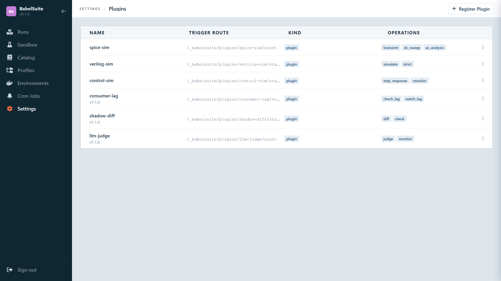

# Plugins

[Back to index](index.md)

Plugins are Lua functions that run inside the APISIX sidecar — no extra container, no image pull. BabelSuite ships two built-in plugins: `babelsuite-traffic-cannon` (all `traffic.*` nodes) and `babelsuite-attack-scanner` (all `security.*` nodes). User plugins follow exactly the same dispatch pattern and run in the same sidecar process — they are just Lua code registered in `configuration.yaml` instead of being bundled with BabelSuite.

## Plugins vs Modules

There are actually **three kinds of topology nodes** in BabelSuite, not two:

| | Modules (`@babelsuite/kafka`, …) | Built-in plugins (`traffic.*`, `security.*`) | User plugins (`@plugins/spice-sim`, …) |
|---|---|---|---|
| **What it is** | A Starlark package that returns topology nodes | Lua code bundled with BabelSuite, running inside the APISIX sidecar | Lua code you write and register, running in the same sidecar |
| **Where the code runs** | Parsed at suite load time — wires up Docker containers | Inside the APISIX process at execution time — no container | Same as built-in plugins — inside APISIX |
| **How it's delivered** | OCI artifact pulled from a registry | Bundled with BabelSuite — always available | Lua source registered in `configuration.yaml` |
| **What it produces** | `service`, `task`, `test` nodes — full containers | A lightweight step: POST config → read JSON verdict | Same pattern as built-in plugins |
| **Startup cost** | Container pull + boot | Zero — sidecar already running | Zero — same sidecar |
| **Use it when** | Spin up infrastructure: broker, database, cache | Load test or security scan a running service | Custom verification: domain-specific checks, external simulators |

`traffic.*` and `security.*` **are plugins** — they are Lua code (`babelsuite-traffic-cannon` and `babelsuite-attack-scanner`) that runs inside the APISIX sidecar, exactly like a user plugin. The only difference is they ship bundled with BabelSuite instead of being registered manually. User plugins follow the exact same dispatch pattern: the backend POSTs a config payload to the sidecar, and reads `passed` / `findings` / `summary` / `level` back.

**Rule of thumb:** if the answer to "does my service need this running while tests execute?" is yes — it's a module. If the answer is "does my pipeline need to verify or probe something?" — it's a plugin (built-in or user-defined).

Examples:
- `@babelsuite/kafka` is a **module** — starts a Kafka broker your services publish to
- `traffic.baseline(target=...)` is a **built-in plugin** — runs load against a service via `babelsuite-traffic-cannon` in the sidecar
- `security.fuzz(target=...)` is a **built-in plugin** — fuzzes endpoints via `babelsuite-attack-scanner` in the sidecar
- `@plugins/consumer-lag` is a **user plugin** — asserts the consumer group has caught up after the test
- `@plugins/pii-scanner` is a **user plugin** — scans your API's response for PII

## How It Works

1. Register a plugin via the API or UI (`Settings → Plugins`). The plugin's Lua source is embedded into the settings file.
2. When a suite that references the plugin runs, BabelSuite writes each plugin's
   Lua to a file and bind-mounts it into the sidecar at
   `/usr/local/openresty/site/lualib/apisix/plugins`, so APISIX loads it **by
   name as a native plugin** — not as a serverless function. It then generates
   an `apisix.yaml` naming the plugin in the top-level `plugins:` list and
   attaching it to a route at the plugin's path.
3. The APISIX sidecar starts once per (suite, profile) pair and stays up across all executions of that combination.
4. For each plugin step the backend POSTs the step config to that route on the sidecar and reads the JSON response back.

### The generated route

A plugin called `llm-judge` produces this block, which is worth recognising when
reading a sidecar's config:

```yaml
- id: babelsuite-plugin-llm-judge
  name: llm-judge
  uri: /_babelsuite/plugins/llm-judge/start
  methods: [POST]
  plugins:
    llm-judge: {}
  upstream:
    type: roundrobin
    nodes:
      127.0.0.1:1: 1
```

The upstream is deliberately unroutable. APISIX requires every route to declare
one, but the request must never reach it: the plugin answers during the `access`
phase and calls `ngx.exit`, so nothing is proxied. If a plugin ever falls
through without responding, the connection fails loudly at `127.0.0.1:1` rather
than silently reaching something real.

The path itself is derived from the plugin name, so it is stated once — see
[Plugin Fields](#plugin-fields).

## Using a Plugin in a Suite

Plugins are loaded with `load("@plugins/<name>", "<operation>")`. Each exported name is a function that creates a topology node.

```python
load("@plugins/spice-sim",   "transient", "dc_sweep")
load("@plugins/verilog-sim", "simulate")
load("@plugins/control-sim", "monitor")

spice_mock   = mock.api(name="spice-service")
verilog_mock = mock.api(name="verilog-service")
control_mock = mock.api(name="control-service")

rc_filter = transient(
    name        = "rc-filter-step-response",
    netlist     = "RC Filter\n...",
    probe_node  = "2",
    max_rise_ms = 3.0,
    max_voltage = 5.5,
    after       = [spice_mock],
)

counter_check = simulate(
    name       = "4bit-counter-correctness",
    top_module = "tb_counter",
    verilog    = "...",
    testbench  = "...",
    timeout_ns = 200,
    after      = [verilog_mock],
)

damper_watch = monitor(
    name        = "mass-spring-damper-response",
    numerator   = [1],
    denominator = [1, 2, 1],
    time_end    = 10,
    after       = [control_mock],
)
```

Plugin nodes accept `after=`, `continue_on_failure=`, and `on_failure=` just like any other topology node.

## What User Plugins Should NOT Duplicate

Before writing a user plugin, check whether the built-in plugins already cover it:

| If you need to… | Use built-in… | NOT a user plugin |
|---|---|---|
| Load-test an endpoint | `traffic.baseline`, `traffic.stress`, `traffic.spike`, … | — |
| Check for SQLi / XSS / path traversal | `security.fuzz` | — |
| Verify auth bypass / open endpoints | `security.auth`, `security.probe` | — |
| Audit security response headers | `security.headers` | — |
| Find CORS misconfigurations | `security.cors` | — |
| Test rate limiting | `security.flood` | — |
| Detect exposed GraphQL introspection | `security.graphql` | — |
| Test dangerous HTTP verbs | `security.verbs` | — |

User plugins are the right tool when the check is **domain-specific** and not covered by the built-ins: hardware simulation, token/claim auditing, schema registry compatibility, Kafka infrastructure assertions, database state checks, etc.

## Example Plugins

Eleven plugins ship under `examples/oci-plugins/`. They cover five domains: hardware simulation, application security, event-streaming health, deployment validation, and output grading.

---

### `spice-sim` — Analog Circuit Simulation

POSTs a SPICE netlist to a simulation backend and checks the resulting waveform against threshold rules. Useful for electronics teams that run automated analog circuit checks as part of a CI pipeline.

| Operation | What it does |
|-----------|--------------|
| `transient` | Runs a time-domain simulation. Checks peak voltage, minimum voltage, and rise time (10%→90%) against configured limits. |
| `dc_sweep` | Runs a DC operating-point sweep. Checks peak and minimum voltage at the probe node. |
| `ac_analysis` | Runs a small-signal AC analysis. Checks the gain in dB at the probe node against a minimum threshold. |

Required config: `sim_url`, `netlist`. Optional: `probe_node`, `max_voltage`, `min_voltage`, `max_rise_ms`, `min_gain_db`, `severity`.

---

### `verilog-sim` — Digital Logic Simulation

Sends Verilog source and a testbench to an Icarus-compatible simulation backend and inspects the results for compile errors, runtime assertion failures, and undefined (X-state) signals.

| Operation | What it does |
|-----------|--------------|
| `simulate` | Runs the testbench. Fails if compile errors exceed zero or simulation errors exceed `max_errors`. X-state assertion is configurable via `assert_no_x`. |
| `strict` | Same as `simulate` but zero-tolerance: any X-state signal, any compile error, any simulation error fails the step immediately. |
| `lint` | Compiles the design without running a testbench — a fast gate for syntax and elaboration errors before the slower `simulate`. Needs no testbench. `fail_on_warnings` promotes compiler warnings to failures. |
| `check_coverage` | Runs the testbench and fails if the simulator's reported toggle coverage falls below `min_coverage_pct` — catches modules that pass every assertion while leaving branches unexercised. |

Required config: `sim_url`, `top_module`. Optional: `verilog`, `testbench` (required except for `lint`), `timeout_ns`, `max_errors`, `assert_no_x`, `fail_on_warnings` (`lint`), `min_coverage_pct` (`check_coverage`, default `80`), `severity`.

---

### `control-sim` — Control System Simulation

Sends a transfer function (numerator/denominator polynomial coefficients) to a scipy-backed simulation service and checks stability and transient response metrics.

| Operation | What it does |
|-----------|--------------|
| `step_response` | Runs a step response simulation. Checks stability (poles in right-half plane), settling time, overshoot percentage, and DC gain. Fails the step on violation. |
| `monitor` | Same checks, but always emits `warn`-level findings — never blocks the suite. Use this for passive observability of control system health. |
| `impulse_response` | Runs an impulse response. Checks stability and settling, plus that the response has decayed back to near zero by `time_end` (`max_residual`) — a marginal system the step test's final-value check can miss. |
| `frequency_response` | Runs a Bode analysis and checks the stability margins: gain margin against `min_gain_margin_db` and phase margin against `min_phase_margin_deg`. These report the headroom a time-domain step never shows. |

Required config: `sim_url`, `numerator`, `denominator`. Optional: `time_end`, `max_settling_time`, `max_overshoot_pct`, `min_dc_gain`, `max_dc_gain`, `max_residual` (`impulse_response`), `min_gain_margin_db` / `min_phase_margin_deg` (`frequency_response`), `severity`.

---

### `jwt-auditor` — JWT Token and Endpoint Security

Application-level JWT security checks. The built-in `security.*` modes check HTTP-layer concerns (headers, CORS, verbs, fuzz payloads). `jwt-auditor` checks what's *inside* the token and whether the endpoint actually enforces signature validation — neither of which the attack scanner covers.

| Operation | What it does |
|-----------|--------------|
| `check_token` | POSTs credentials to `auth_url`, extracts the JWT from the response, decodes the header and payload, and audits: algorithm (`none` is critical, HMAC symmetric is a warning), missing `exp` claim, token lifetime exceeding `max_lifetime_hours`, and missing required claims (`sub`, `iss`, `exp`, `iat` by default). |
| `audit_endpoint` | Gets a valid token first, then probes `endpoint` three ways: no Authorization header (must be 401/403), tampered signature (must be 401/403), and valid token (must be 2xx). Flags any case where the endpoint accepts what it shouldn't. |
| `check_claims` | Fetches a token and checks its claims against expected values: the `expected_issuer` it must carry, the `expected_audience` it must include, and any `forbidden_scopes` it must not grant. A structurally valid token can still name the wrong issuer or carry an over-broad scope. |
| `audit_endpoints` | Runs the `audit_endpoint` checks over a list of `endpoints`, so one step covers every protected route. Each endpoint's findings are prefixed with its URL. |

Required config: `auth_url`, `username`, `password`. Optional: `token_field` (default `token`), `endpoint` (required for `audit_endpoint`), `endpoints` (required for `audit_endpoints`), `expected_issuer` / `expected_audience` / `forbidden_scopes` (`check_claims`), `max_lifetime_hours` (default `24`), `required_claims`, `severity`.

---

### `canary-validator` — Canary Deployment Traffic Ratio

> **Note:** this plugin makes HTTP requests to check traffic routing. The built-in `traffic.*` nodes handle load generation — this plugin is specifically for validating that the *split ratio* itself is correct, which is a different concern.

Sends N requests to a target URL and counts how many responses carry a canary header. Checks that the observed ratio matches the expected split within a tolerance band. Useful for validating that a canary deployment is receiving exactly the right percentage of traffic.

| Operation | What it does |
|-----------|--------------|
| `validate` | Checks the observed canary ratio against `expected_ratio ± tolerance`. Fails if out of range. |
| `watch_ratio` | Same check but with a wider default tolerance and `warn`-level findings — passive monitoring mode. |
| `sticky` | Sends every request with the same `session_value` on `session_header` and fails if they do not all land on one side. A session that reaches both the canary and stable versions means a user would bounce between them mid-session. |
| `compare_errors` | Splits the sample by which side answered and compares the 5xx rate of each. Fails if the canary's error rate exceeds stable's by more than `max_error_delta`, or if no canary traffic was seen at all. |

Required config: `target`. Optional: `canary_header` (default `X-Canary`), `expected_ratio` (default `0.1`), `tolerance` (default `0.05`), `sample_size` (default `100`), `session_header` / `session_value` (`sticky`), `max_error_delta` (`compare_errors`, default `0.01`), `severity`.

---

### `consumer-lag` — Kafka Consumer Group Lag

Queries a Kafka REST Proxy for a consumer group's partition offsets and checks whether any partition's lag exceeds a threshold. Useful after a load test or data ingestion task to confirm the consumer has fully caught up.

| Operation | What it does |
|-----------|--------------|
| `check_lag` | Checks every partition in the group. Fails with `critical` if any partition lag exceeds `max_lag`. |
| `watch_lag` | Same check but always `warn`-level — use for continuous observability. |
| `wait_caught_up` | Polls until the group's total lag drops to `max_lag` or `timeout_s` passes. A load test ends long before its consumers drain, so a single `check_lag` right after it reports lag that would have cleared. |
| `check_trend` | Samples the total lag twice, `interval_s` apart, and fails if it grew by more than `max_growth`. A high but shrinking lag is a consumer catching up; a growing one cannot keep pace with its producers. |

Required config: `kafka_rest_url`, `group`. Optional: `max_lag` (default `1000`), `timeout_s` / `interval_s` (`wait_caught_up`, defaults `60` / `2`), `interval_s` / `max_growth` (`check_trend`, defaults `10` / `0`), `severity`.

---

### `dlq-inspector` — Dead Letter Queue Inspector

Checks the latest offset of a Kafka DLQ topic via the REST Proxy. A non-zero (or above-threshold) offset means messages were dead-lettered during the test run.

| Operation | What it does |
|-----------|--------------|
| `inspect` | Fails the step if the DLQ topic has more messages than `max_messages`. |
| `watch_dlq` | Same check but always `warn`-level — never blocks the suite. |
| `check_growth` | Samples the DLQ's message count twice, `interval_s` apart, and fails if it grew by more than `max_growth`. The absolute count includes everything dead-lettered before the run; growth isolates what is being dead-lettered right now. |
| `inspect_topics` | Runs `inspect` over a list of `topics` in one step, each over-limit topic its own finding — no need for an `inspect` step per DLQ. |

Required config: `kafka_rest_url`, `topic` (or `topics` for `inspect_topics`). Optional: `max_messages` (default `0`), `interval_s` / `max_growth` (`check_growth`, defaults `10` / `0`), `severity`.

---

### `pii-scanner` — PII Leak Detection

> **Note:** this plugin makes an HTTP GET to a URL and scans the body. The built-in `security.probe` checks for *access control* on sensitive paths — `pii-scanner` checks for *data leakage* in the response body, which is a different concern.

Fetches a URL and scans the response body for PII patterns using regex. Ships with built-in patterns for credit card numbers, SSNs, email addresses, and private keys. Additional patterns can be provided per-step.

| Operation | What it does |
|-----------|--------------|
| `scan` | Fetches `target` and fails if any PII pattern matches. Use this as a hard gate in your pipeline. |
| `probe` | Same scan but always `warn`-level — passive auditing mode. |
| `scan_headers` | Scans the response *headers* rather than the body — an email in a `Set-Cookie`, a card number echoed in a debug header, a token in `Location`. Each header is named in its finding. |
| `scan_many` | Scans a list of `targets` in one step, so a suite can sweep every read path of an API. An unreachable target is a `warn`-level finding, not a hard failure. |

Required config: `target` (or `targets` for `scan_many`). Optional: `patterns` (list of extra regex strings), `severity`.

---

### `schema-compat` — Avro Schema Compatibility

Posts a new schema to a Confluent-compatible Schema Registry compatibility endpoint and checks whether it is compatible with the current version for a given subject.

| Operation | What it does |
|-----------|--------------|
| `check_compat` | Checks compatibility using the mode in `mode` (`BACKWARD`, `FORWARD`, `FULL`, etc.). |
| `enforce` | Always checks `FULL` compatibility (both backward and forward). Use this as a hard gate before publishing a new schema version. |
| `check_registered` | Asks the registry whether `new_schema` is already a registered version of the subject. Run it after the step that publishes a schema, to prove the schema the service will look up by id is really there; reports the version and id. |
| `check_mode` | Reads the compatibility level the registry actually enforces for the subject (falling back to the global level) and fails if it is not `mode`. A subject quietly set to `NONE` accepts any change, which makes every `check_compat` against it meaningless. Needs no `new_schema`. |

Required config: `registry_url`, `subject`, `new_schema` (not needed for `check_mode`). Optional: `mode` (default `BACKWARD`), `severity`.

---

### `shadow-diff` — Shadow Traffic Response Diffing

> **Note:** this plugin makes HTTP requests to two targets. The built-in `traffic.*` nodes generate load — `shadow-diff` is for *migration validation*, comparing the response payloads of an old and new implementation, which traffic nodes don't do.

Fetches the same endpoint from two targets — a primary and a shadow — and compares the JSON responses field by field. Useful for validating a new service version before switching traffic.

| Operation | What it does |
|-----------|--------------|
| `diff` | Fails the step if the number of field-level differences exceeds `threshold`. Useful as a hard gate during migration. |
| `check` | Same diff but always `warn`-level — passive shadow monitoring. |
| `compare_paths` | Treats `primary` and `shadow` as base URLs and diffs every path in `paths` on both, each differing path named in its findings. A migration is rarely one endpoint. |
| `compare_latency` | Sends `samples` requests to each side and fails if the shadow's median latency is more than `max_ratio` times the primary's. A shadow that returns identical payloads twice as slowly is not ready for traffic. |

Required config: `primary`, `shadow` (base URLs for `compare_paths`). Optional: `ignore_fields` (list of field paths to skip), `threshold` (default `0`), `paths` (`compare_paths`), `samples` / `max_ratio` (`compare_latency`, defaults `10` / `1.5`), `severity`.

---

### `llm-judge` — Grading Text Against Criteria

Sends a block of text and a list of criteria to any OpenAI-compatible
chat-completions endpoint, and asks the model to answer each criterion `yes` or
`no` independently. The score is the fraction answered `yes`, so a partial pass
is visible instead of collapsing into one opaque rating, and every `no` carries
the model's own reason into a finding.

Grade either text supplied inline with `output`, or the body of a URL named by
`target`.

| Operation | What it does |
|-----------|--------------|
| `judge` | Fails the step when the score falls below `threshold`. Use as a gate. |
| `monitor` | Reports the same verdicts at `warn` level without failing the suite. |
| `consistency` | Grades the same text `rounds` times and fails if the score varies by more than `max_spread`. A judge whose verdict flips between runs cannot gate a pipeline; this measures that instability directly. |
| `compare` | Grades two candidate texts (`output_a`, `output_b`) against the same criteria and fails when the `prefer`red side (default `a`, the baseline) does not score highest — so a regression in a new prompt or model shows up as a step failure. |

Required config: `model_url`, `criteria`. One of `output` or `target`. Optional:
`model` (default `gpt-4o-mini`), `api_key`, `threshold` (default `1.0`),
`timeout_ms` (default `30000`), `severity`, `structured` (default `true`).

!!! warning "Keep `structured` on unless the endpoint rejects it"
    It asks the server to constrain decoding to a JSON object. Instructions
    alone are not enough — models wrap the answer in prose or stop mid-object,
    and the reply is then unparseable. Turn it off only for an endpoint that
    returns an error for `response_format`.

Reports `judge.score`, `judge.passed`, `judge.total`, `judge.threshold`,
`judge.model` and `judge.status` to the step's trace span. When the model cannot
be reached or answers unusably, the step reports a `judge.unavailable` finding
with `judge.status=unavailable` rather than failing as a transport error, so the
reason survives into the run and the trace — and `monitor` keeps its promise not
to block the suite.

---

## Plugin Fields

| Field | Description |
|-------|-------------|
| `name` | Unique identifier — used as the load target in `suite.star` (e.g. `@plugins/spice-sim`) |
| `trigger` | Read-only. The sidecar route the plugin answers on, derived from `name` as `/_babelsuite/plugins/<name>/start`. A plugin package does not declare it and a value sent to the API is ignored. |
| `version` | Semantic version string stored as-is — e.g. `1.0.0`. Not auto-bumped by the API. |
| `kind` | Must be `plugin` |
| `variants` | List of variant names the plugin registers as APISIX Lua extensions |
| `operations` | Optional list of allowed operation names — the suite call must match one |
| `lua` | Full Lua source. Written to a file and bind-mounted into the sidecar's plugin directory, where APISIX loads it by name as a native plugin |
| `schema` | Optional CUE schema; step config is validated against it before dispatch |
| `star` | Starlark wrapper source — defines the typed functions suite authors call via `load("@plugins/<name>", ...)`. See [Plugin Starlark Wrapper](#plugin-starlark-wrapper-pluginstar). |
| `deprecated` | When `true`, the plugin is flagged in health checks but still dispatched |

## Plugin Response Contract

The Lua plugin's HTTP handler must return a JSON body. BabelSuite reads these fields:

| Field | Type | Description |
|-------|------|-------------|
| `passed` | bool | Whether the step should be considered successful |
| `findings` | array | List of finding objects, each with `label`, `severity` and `detail` |
| `summary` | string | One-line summary emitted as a log line at the level set by `level` |
| `level` | string | Log level for the summary: `info`, `debug`, `warn`, or `error`. Defaults to `info` if omitted. |
| `stderr` | string | Optional raw stderr from the plugin process, shown in the execution log |
| `attributes` | object | Optional string map recorded on the step's OpenTelemetry span, prefixed `runner.plugin.` |

### Reporting to the trace

The runner opens a `runner.run` span per step carrying what the runner knows — execution, suite, node and backend. `attributes` is how a plugin adds what it actually did, so the detail reaches your collector alongside everything else BabelSuite traces.

```lua
return {
    passed     = ok,
    findings   = findings,
    attributes = {
        ["lag.max"]   = tostring(max_lag),
        ["lag.group"] = group,
    },
}, nil
```

Those arrive on the span as `runner.plugin.lag.max` and `runner.plugin.lag.group`.

The shipped `consumer-lag` and `shadow-diff` plugins report this way — lag totals and thresholds, diff counts and upstream statuses.

!!! warning "Keep attribute values low-cardinality"
    Trace backends index span attributes, so a value that is unique per call — a request id, a full prompt — multiplies the index. Report scores, counts, modes and names; never per-call identifiers. BabelSuite caps each step at 24 attributes and truncates values at 256 characters, but the cap is a backstop, not a licence.

Minimal compliant Lua return:

```lua
local ok = #findings == 0
return {
    passed   = ok,
    findings = findings,
    summary  = ok and "All checks passed." or string.format("%d finding(s).", #findings),
    level    = ok and "info" or "warn",
}, nil
```

## API

Registered plugins are listed under **Settings → Plugins**, each with its trigger route and the operations it exposes to suite steps.



All plugin endpoints require an admin session except `check` and `validate`.

| Method | Path | Description |
|--------|------|-------------|
| `GET` | `/api/v1/platform-settings/plugins` | List all registered plugins |
| `POST` | `/api/v1/platform-settings/plugins` | Register a new plugin |
| `PUT` | `/api/v1/platform-settings/plugins/{name}` | Update an existing plugin in-place |
| `DELETE` | `/api/v1/platform-settings/plugins/{name}` | Remove a plugin |
| `GET` | `/api/v1/platform-settings/plugins/{name}/check` | Static health check: validates trigger path and CUE schema |
| `POST` | `/api/v1/platform-settings/plugins/{name}/validate` | Validate a step config object against the plugin's CUE schema |

### Register

```bash
curl -s -X POST http://localhost:8090/api/v1/platform-settings/plugins \
  -H "Authorization: Bearer $TOKEN" \
  -H "Content-Type: application/json" \
  -d '{
    "name":       "spice-sim",
    "version":    "1.0.0",
    "kind":       "plugin",
    "variants":   ["spice-sim"],
    "operations": ["transient", "dc_sweep", "ac_analysis"],
    "lua":        "<lua source>",
    "schema":     "<cue schema>"
  }'
```

### Update in-place

```bash
curl -s -X PUT http://localhost:8090/api/v1/platform-settings/plugins/spice-sim \
  -H "Authorization: Bearer $TOKEN" \
  -H "Content-Type: application/json" \
  -d '{ "lua": "<updated lua>", ... }'
```

The plugin name is taken from the URL — the `name` field in the body is ignored.

## APISIX Sidecar Lifecycle

Each unique (suite, profile) pair gets one long-lived APISIX sidecar container. The sidecar starts on the first execution of that pair and remains up across all subsequent executions. Plugin Lua is bind-mounted and the generated `apisix.yaml` names each plugin, both read at sidecar startup — so removing the sidecar container is what forces it to pick up changed plugin code on the next execution.

Because one sidecar serves every execution of that pair, including concurrent ones, it is not a per-execution component: it never joins the per-execution network and is reached over its host-published port.

The sidecar runs in **standalone mode**: `deployment.role: data_plane` with `config_provider: yaml`. No etcd is involved.

## Using Plugins Inside Modules

Modules can load and re-export plugins just like they load `@babelsuite/runtime`. The `@plugins/<name>` path is resolved through the same mechanism inside module `.star` files, so a module can bundle both infrastructure setup **and** plugin-backed verification helpers in one package.

```python
# examples/oci-modules/kafka/admin.star
load("@babelsuite/runtime",    "task")
load("@plugins/consumer-lag",  "check_lag")
load("@plugins/dlq-inspector", "inspect")

def check_consumer_health(broker, group, topic, kafka_rest_url,
                          max_lag = 1000, after = []):
    lag = check_lag(
        name             = broker.name + "-lag-" + group,
        kafka_rest_url   = kafka_rest_url,
        group            = group,
        max_lag          = max_lag,
        after            = [broker] + after,
    )
    dlq = inspect(
        name           = broker.name + "-dlq-" + topic,
        kafka_rest_url = kafka_rest_url,
        topic          = topic + ".DLQ",
        max_messages   = 0,
        after          = [lag],
    )
    return lag, dlq
```

A suite then gets both the infrastructure and the verification checks from a single module load:

```python
load("@babelsuite/kafka", "kafka", "create_topic", "check_consumer_health")

broker  = kafka()
topic   = create_topic(broker, "orders", partitions=3)
app     = service.run(image="orders-app:latest", after=[topic])
lag, dlq = check_consumer_health(
    broker,
    group          = "orders-consumer",
    topic          = "orders",
    kafka_rest_url = "http://kafka:8082",
    after          = [app],
)
```

The plugins referenced inside a module must still be registered in platform settings before any suite that loads the module can run — the module provides the Starlark API, but the Lua code runs in the APISIX sidecar at execution time.

## Plugin Starlark Wrapper (`plugin.star`)

Every plugin ships a `plugin.star` file alongside its Lua source. This file is the **Starlark API surface** of the plugin — it defines the named functions that suite authors call in `suite.star`, with typed parameters and defaults, and forwards them to the underlying plugin dispatcher.

Without `plugin.star`, a suite would have to call the plugin with raw keyword arguments and remember every field name and default. With it, the suite just calls `transient(name=..., netlist=..., max_rise_ms=3.0)` — the wrapper handles the rest.

### Structure

```python
load("@babelsuite/runtime", "plugin")

_ref = plugin("spice-sim")          # bind to the registered plugin by name

def transient(name, netlist,         # typed, documented parameters
              probe_node = "out",
              max_rise_ms = None,
              max_voltage = None,
              sim_url = "",
              severity = "critical",
              after = []):
    return _ref.transient(           # forward to the dispatcher
        name        = name,
        after       = after,
        netlist     = netlist,
        probe_node  = probe_node,
        max_rise_ms = max_rise_ms,
        max_voltage = max_voltage,
        sim_url     = sim_url,
        severity    = severity,
    )
```

Each exported function corresponds to one operation in the plugin's `operations` list. The function name must match the operation name exactly — that is how the backend knows which operation to pass to the Lua handler.

### How it's used in a suite

```python
load("@plugins/spice-sim", "transient", "dc_sweep")

rc_filter = transient(
    name        = "rc-filter",
    netlist     = "...",
    probe_node  = "2",
    max_rise_ms = 3.0,
    after       = [spice_mock],
)
```

The `load("@plugins/spice-sim", "transient")` resolves the `plugin.star` file for `spice-sim` and imports the `transient` function from it.

### Relationship to `plugin.yaml`

The `plugin.yaml` field `star: plugin.star` tells BabelSuite where the Starlark wrapper lives. When the registration API receives it (via the `star` field on `CustomPlugin`), the content is stored alongside the Lua source and served to suite authors via the `@plugins/<name>` load path.

### Writing a `plugin.star`

1. Load `plugin` from `@babelsuite/runtime` and bind it to your plugin name.
2. Define one function per operation. Parameter names must match the config keys your Lua handler reads from `payload.config`.
3. Always forward `name=` and `after=` — these are topology fields, not config fields.
4. Set sensible defaults so callers only have to specify what they care about.

```python
load("@babelsuite/runtime", "plugin")

_ref = plugin("my-checker")

def check(name, target, threshold = 100, severity = "critical", after = []):
    return _ref.check(
        name      = name,
        after     = after,
        target    = target,
        threshold = threshold,
        severity  = severity,
    )
```

## Plugin Definition Files

The example plugins under [`examples/oci-plugins/`](examples.md#example-plugins) each ship four files:

| File | Purpose |
|------|---------|
| `plugin.yaml` | Manifest — name, version, operations, and references to the other files |
| `plugin.lua` | Lua source embedded into the APISIX sidecar |
| `plugin.star` | Starlark wrapper — typed functions for `suite.star` authors |
| `schema.cue` | CUE schema for validating step config before dispatch |

`plugin.yaml` example:

```yaml
name: spice-sim
version: 1.0.0
kind: plugin
variants: [spice-sim]
operations: [transient, dc_sweep, ac_analysis]
schema: schema.cue
lua: plugin.lua
star: plugin.star
```

The `schema`, `lua`, and `star` fields are file references — the registration script reads them and sends the content inline to the API. Versions live in the definition file and are not auto-bumped by the backend.

## UI

Plugins are managed at **Settings → Plugins** (`/settings/plugins`). The page lists all registered plugins, shows their version and operations, and lets admins register, edit, or delete them.
