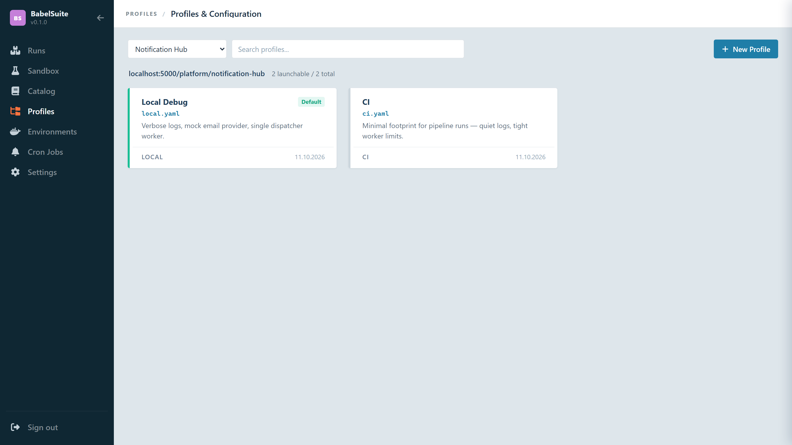

# Profiles

[Back to index](index.md)

## What Profiles Do

Profiles are the launch-time configuration layer for a suite. They allow the same suite topology to run differently across environments such as local development, CI, staging, canary, or event-specific scenarios.

A profile can:

- set environment variables for the run
- select module hints and observability settings
- override individual service env vars — including `devices:` for hardware passthrough and `memory:` for a per-step memory ceiling
- configure the execution network mode (`network.mode`)
- declare secret-backed env vars with `secretRefs`
- inherit from another profile via `extendsId`



## Profile Sources

BabelSuite has two profile representations:

| Source | Location | Purpose |
|--------|----------|---------|
| **Workspace files** | `examples/oci-suites/<suite>/profiles/*.yaml` | Package-owned defaults, runtime overlays, and inline `secretRefs` that travel with the suite |
| **Managed records** | `babelsuite-profiles.yaml` / profiles API | Operator-managed overlays, secret bindings, UI-editable |

Workspace files drive the initial profile list for each suite. Managed records support creation, updates, deletion, and default selection through the UI and API.

## Workspace Profile Shape

Common checked-in profile shape:

```yaml
name: Local Debug
description: Verbose logs, local secrets, and relaxed timeouts.
default: true
runtime:
  suite: payment-suite
  repository: localhost:5000/core-platform/payment-suite
  profileFile: local.yaml
modules:
  - postgres
  - kafka
observability:
  logs: structured
  traces: enabled
  metrics: enabled
secretRefs:
  - key: DB_PASSWORD
    provider: Vault
    ref: kv/payment-suite/staging-db-password
env:
  PAYMENTS_API_BASE_URL: https://payments.staging.company.test
services:
  payment_gateway:
    env:
      API_PORT: 8080
```

Workspace suite discovery uses `name`, `description`, `default`, `runtime.repository`, `runtime.profileFile`, and `modules` from this structure. Profile loading and execution also consume optional `env`, `services.<step>.env`, and `secretRefs` blocks from the same YAML body.

## Managed Profile Record Fields

Profiles stored via the API expose:

| Field | Description |
|-------|-------------|
| `id` | Record identifier |
| `name` | Display name |
| `fileName` | YAML filename (must end in `.yaml` or `.yml`) |
| `description` | Optional description |
| `scope` | Suite scope this profile belongs to |
| `yaml` | The profile YAML payload (validated on write) |
| `secretRefs` | Resolved secret references (`key`, `provider`, `ref`) exposed to the UI/API |
| `default` | Whether this is the default profile for the suite |
| `extendsId` | ID of a parent profile to inherit from |
| `launchable` | Whether this profile appears in the launch UI |
| `updatedAt` | Last modified timestamp |

The `yaml` payload supports:

```yaml
# Execution-scoped Docker network — all containers reachable by node name
network:
  mode: execution   # or: host | none (default: no dedicated network)

secretRefs:
  - key: API_TOKEN
    provider: Vault
    ref: kv/service/api-token

env:
  LOG_LEVEL: debug
  TELEMETRY_PROFILE: verbose

services:
  api:
    env:
      API_MODE: strict
  seed-job:
    # Hardware devices attached to this step's container
    devices: ["gpu"]           # nvidia GPU (all)
    # devices: ["gpu:2"]       # exactly 2 GPUs
    # devices: ["/dev/ttyUSB0"] # USB serial device
    memory: 2Gi                # container memory ceiling for this step
```

### `network.mode`

| Value | Behaviour |
|-------|-----------|
| `execution` | One isolated Docker bridge network per execution. Every container joins it and is reachable by its node `name` as hostname — e.g. `redis:6379`, `payment-gateway:8080`. Network is created at execution start and removed when the execution finishes. |
| `host` | Containers share the host network stack. |
| `none` or omitted | Docker default bridge — containers are isolated from each other. |

!!! warning "Read but not yet acted on"
    The Docker backend creates and joins the per-execution network in every
    profile, because the shipped modules address other steps by name whether or
    not a profile opted in — `connect()` dials `<db name>:5432` regardless. The
    value is parsed and stored, but `host` and `none` change nothing today.

When suites are composed, a service name that more than one of them declares
gets a single publisher rather than being shared — see
[Runtime Library](runtime-library.md#service-names-when-suites-are-composed).

### `services.<name>.devices`

Hardware devices to pass through into the step's container. The profile controls which hardware each step gets; `suite.star` stays portable.

| Value | Docker | Kubernetes |
|-------|--------|-----------|
| `"gpu"` | nvidia `DeviceRequest` (all GPUs) | `nvidia.com/gpu: 1` limit + toleration |
| `"gpu:N"` | N GPUs | `nvidia.com/gpu: N` |
| `"/dev/foo"` | `DeviceMapping` bind | `smarter-devices/foo: 1` |

Different profiles can assign different hardware to the same node:

```yaml
# local.yaml — no GPU
services:
  seed-job:
    env:
      BATCH_SIZE: "100"

# perf.yaml — GPU for large batch
services:
  seed-job:
    devices: ["gpu"]
    env:
      BATCH_SIZE: "50000"
```

### `services.<name>.memory`

Container memory ceiling for one step. Step containers default to 512 MB, which
is ample for a script but not for a step that hosts a process with a large
working set — a model server, a JVM, an in-memory fixture. Raising it per step
keeps that default, and the protection it gives, for every other step.

Values use the same quantity grammar as Kubernetes, so the Docker and
Kubernetes backends agree on what a profile means. The suffixes are
**case-sensitive**.

| Value | Meaning |
|-------|---------|
| `2Gi`, `512Mi`, `1Ki` | Binary units — 1024-based |
| `2G`, `512M`, `2k` | Decimal units — 1000-based (note the lower-case `k`) |
| `1.5Gi` | Fractions are allowed |
| `2147483648` | A plain byte count |
| omitted, zero, negative, or unparseable | Default ceiling, currently 512 MB |

`2GB`, `512MB` and an upper-case `2K` are **not** valid suffixes and are
ignored, leaving the step on the default. Values below the 6 MB floor Docker
enforces fail the step with a named error rather than an opaque daemon
rejection.

```yaml
# local.yaml — only the model server gets more
services:
  ollama:
    memory: 2Gi
```

It is a ceiling, not a reservation: the step consumes only what it touches, and
is OOM-killed if it exceeds this. A step whose process dies with
`signal: killed` part-way through start-up is the signature of this limit being
too low.

Like `devices:`, the entry may be keyed by either the node id or the node name.

## Default Selection

At launch time:

1. The explicitly chosen profile wins.
2. Otherwise the profile marked `default: true` is used.
3. Otherwise the first available profile is used.

## Suite Dependency Profiles

Nested suite dependencies can declare their own runtime profile in `dependencies.yaml`:

```yaml
dependencies:
  auth-module:
    ref: localhost:5000/core-platform/identity-broker
    version: 1.2.0
    profile: canary.yaml
```

That selected profile travels with the imported suite's resolved topology and step specs. The resolver reads the child suite's `profiles/canary.yaml` and applies its `env:` and per-service `services.<step>.env:` overlays to imported nodes before execution.

## Managed Profile Endpoints

| Method | Endpoint | Action |
|--------|----------|--------|
| `GET` | `/api/v1/profiles/suites` | List suite profile summaries |
| `GET` | `/api/v1/profiles/suites/:suiteId` | Get profiles for one suite |
| `POST` | `/api/v1/profiles/suites/:suiteId` | Create a profile |
| `PUT` | `/api/v1/profiles/suites/:suiteId/:profileId` | Update a profile |
| `DELETE` | `/api/v1/profiles/suites/:suiteId/:profileId` | Delete a profile |
| `POST` | `/api/v1/profiles/suites/:suiteId/:profileId/default` | Mark as default |

See [API](api.md) for the full route reference.

## Related Pages

- [Profile Runtime Reference](profile-runtime.md) - workspace vs managed profiles in depth, runtime overlays, dependency profile flow
- [Suites](suites.md) - how profiles relate to suite packages and launch options
- [Dependency Manifests](dependencies.md) - how dependency `profile` and `inputs` travel with nested suites
